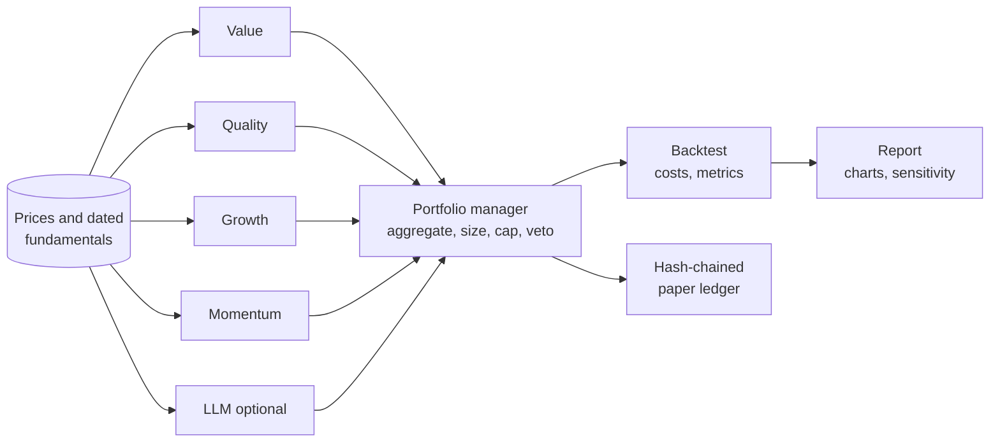
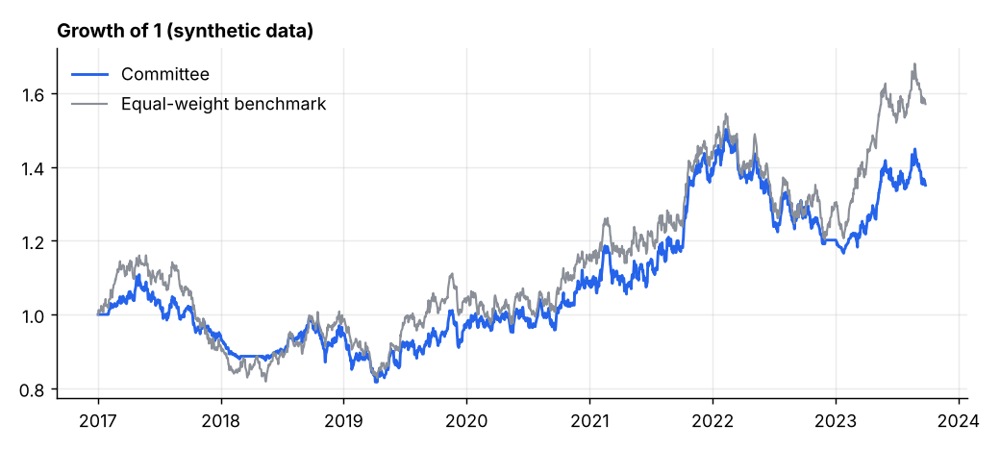

# investment-committee

[](https://github.com/amen-bedoui/investment-committee/actions)
 

**Explainable multi-agent equity screening, point-in-time backtesting and a tamper-evident paper-trading ledger.**

> **Disclaimer.** Educational research project. It places no orders and gives no investment advice. The bundled data is **synthetic**: results on it say nothing about real markets.

Five analyst agents (value, quality, growth, momentum, trend) each emit a bounded signal with a confidence and a one-line rationale. A portfolio manager aggregates them, sizes positions by volatility, applies a position cap and a drawdown veto, and a backtester replays the process month by month with transaction costs and **no look-ahead**. Inspired by the idea of [virattt/ai-hedge-fund](https://github.com/virattt/ai-hedge-fund); independent, deterministic implementation (the core needs no API key, an LLM analyst is optional).





*Synthetic market with no built-in edge: the committee does not beat the benchmark, as it should not.* Full generated report: [`docs/example_report/report.md`](docs/example_report/report.md).

## Real-data result (140 years of US equities)
Committee as a timing overlay (momentum + trend, 100 % invested or cash, 10 bps cost, 1-day execution lag, parameters fixed in advance), daily total-return data 1885-2025 ([`docs/real_world_us_equities/report.md`](docs/real_world_us_equities/report.md)):

| Primary era 1962-2025 | CAGR | Sharpe | Max drawdown |
|---|---|---|---|
| Committee timing | +10.8 % | 0.53 | -33.7 % |
| Buy and hold | +10.9 % | 0.44 | -55.2 % |

**Honest reading.** The overlay did not add return (excess -0.6 %/yr, 90 % bootstrap interval -2.6 % to +1.7 %: not distinguishable from zero) but cut the worst drawdown and lifted the Sharpe ratio. It protected in 1973-74 (+1.4 % vs -43 %), 2000-02 and 2008-09, and did **not** protect in the 2020 crash (-33.7 % both). Re-choosing parameters each year out-of-sample did *worse* than the fixed default (8.7 % vs 9.8 %), and the default threshold happens to be the best cell of its grid: the headline Sharpe is optimistic. The data source says it is only good for crude buy-and-hold backtests; results are indicative. Reproduce: `committee timing`.

## Real-data result (12 ETFs, 2001-2023)
Multi-asset version (momentum + trend, 25 % cap, -30 % drawdown veto, 10 bps, cash earns the T-bill rate), Yahoo total returns, report in [`docs/real_world_etf/report.md`](docs/real_world_etf/report.md):

| 2001-2023 | CAGR | Sharpe | Max drawdown |
|---|---|---|---|
| Committee | +6.1 % | 0.55 | -13.9 % |
| SPY | +7.4 % | 0.38 | -55.2 % |
| Equal-weight basket | +5.5 % | 0.38 | -34.0 % |

**Honest reading.** Much lower risk (drawdown -14 % vs -55 %, 2008: +4.5 % vs -54.7 %, 2022: -4.9 % vs -18.2 %) but **lower return than SPY** (-2.0 %/yr, 90 % bootstrap interval -7.1 % to +2.9 %: not significant). It won 2001-2012 (+7.2 % vs +2.5 %) and **lost 2012-2023** (+4.9 % vs +12.6 %, Sharpe 0.52 vs 0.71) when US large caps dominated. The COVID crash was only partly absorbed (-6.1 % vs -33.7 %). Walk-forward re-selection scored Sharpe 0.68 vs 0.58 for the fixed default. Data end in June 2023 and the ETF list was picked with hindsight of survival.

## Does it work on fresh data? Run the ETF study yourself
```bash
./run_real_study.sh        # or double-click run_real_study.bat on Windows
```
Downloads 19 ETFs (2005 to today), runs a **pre-registered protocol** (no tuning on the sample) against SPY and an equal-weight basket, and writes a report with stress windows, cost and parameter sensitivity and a bootstrap interval for the excess return. Protocol and how to read it: [`docs/REAL_WORLD_STUDY.md`](docs/REAL_WORLD_STUDY.md). The synthetic example below only validates the plumbing.

## Install
```bash
pip install .            # core
pip install ".[live]"    # + real prices (yfinance)
pip install ".[llm]"     # + optional LLM analyst (anthropic)
pip install -e ".[dev]"  # development: pytest, ruff
```

## Usage
```bash
committee demo                                              # synthetic market: decisions + backtest
committee report --out report/                              # markdown report with charts and sensitivity
committee fetch --tickers AAPL MSFT NVDA MC.PA --out prices.csv
committee backtest --prices prices.csv                      # price-only (momentum + risk rules)
committee backtest --prices prices.csv --fundamentals f.csv --config examples/mandate.json
committee analyze  --prices prices.csv --live               # today's decisions, current fundamentals snapshot
committee analyze  --prices prices.csv --live --llm         # + LLM second opinion (ANTHROPIC_API_KEY)
committee paper    --prices prices.csv --live --ledger ledger.jsonl   # record today's decisions
committee verify   --ledger ledger.jsonl                    # detect tampering
committee performance --prices prices.csv --ledger ledger.jsonl      # realised paper performance
```

**Input formats.** Prices: CSV with `date` and one column per ticker (adjusted close). Fundamentals: CSV with `date` (publication date), `ticker`, `pe, pb, fcf_yield, roe, net_margin, debt_ebitda, rev_growth`. Mandate: JSON, see [`examples/mandate.json`](examples/mandate.json) (unknown keys are rejected).

## What makes it trustworthy
- **No look-ahead**: fundamentals are joined as of publication date; a test multiplies all future prices by 5 and requires identical decisions.
- **Honest null test**: on a synthetic market without edge the pipeline shows none (re-run on v1.4.1 over 30 seeds: -1.2 %/year on average versus the equal-weight basket, 6 wins out of 30; costs and concentration, no manufactured edge).
- **Robustness**: every report includes a parameter sensitivity grid and, in the real-data study, a walk-forward out-of-sample track record.
- **Explainable**: each signal carries its rationale; the CLI prints the per-agent score table.
- **Tamper-evident ledger**: edited or deleted sessions are detected by `verify`.
- **Fails loudly**: price files are validated (duplicates, non-positive values, unadjusted splits); the CLI returns clean errors.
- **45 tests**, ruff-clean, CI on every push.

## Limits (read before using)
Thresholds are author choices and not calibrated. No real-market performance is claimed. Yahoo fundamentals are a current snapshot, so they are used for live analysis only, never in a historical backtest; the LLM analyst is excluded from backtests (non-deterministic, may know the future of past dates). The yfinance and Anthropic calls are covered by offline tests but were not run against the live services by the author. Details: [`docs/METHODOLOGY.md`](docs/METHODOLOGY.md).

## Layout
`src/committee/` agents, portfolio, backtest, ledger, report, data, live, llm_agent, cli · `tests/` · `docs/` · `examples/`

MIT licence.


## Optional: Claude analyst and live data
See [docs/LLM_SETUP.md](docs/LLM_SETUP.md). One click: `run_live.bat` / `run_live.sh`; or `committee llm-check` then `committee live --tickers AAPL MSFT --llm`.
