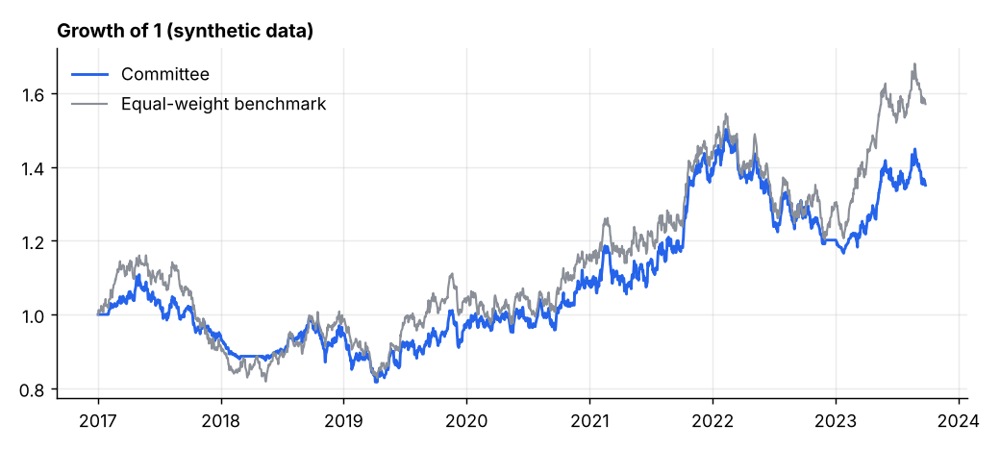
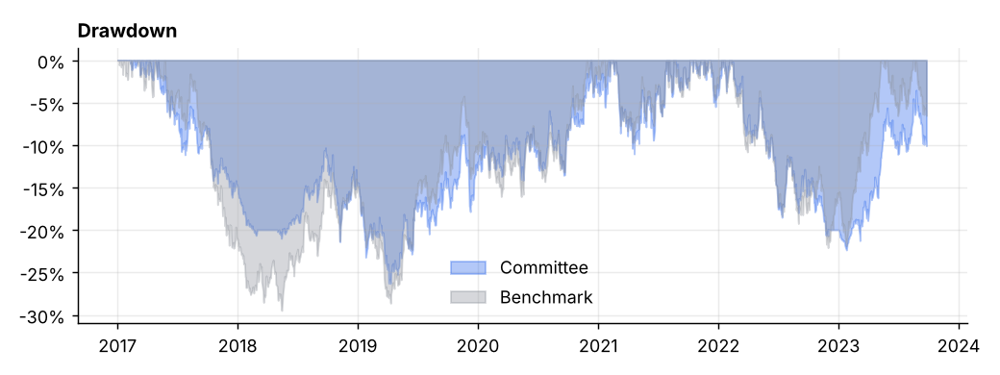
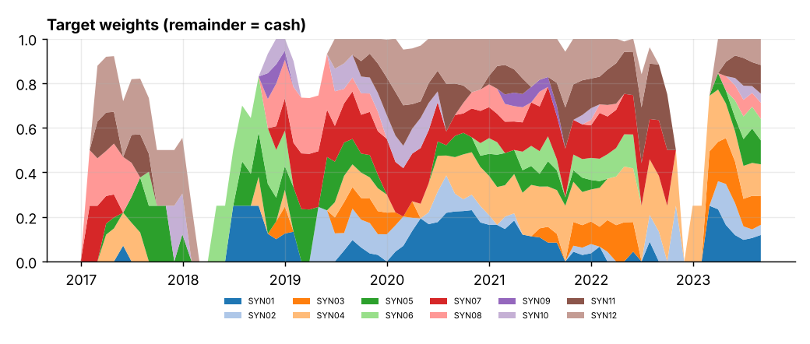
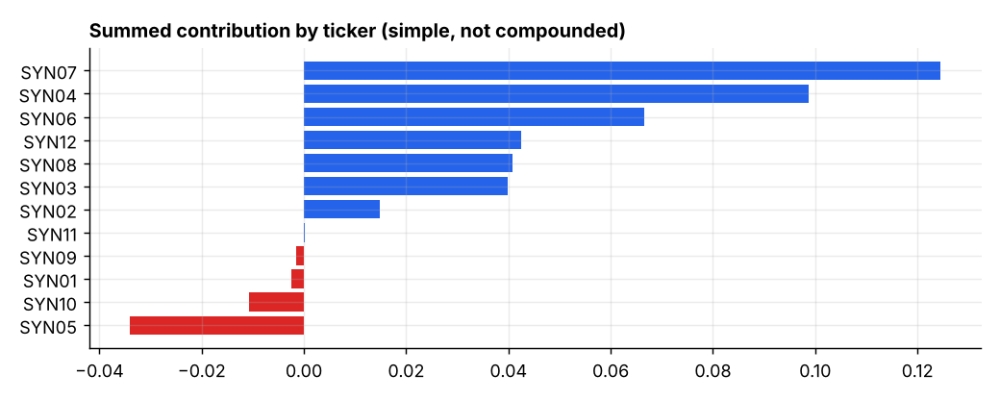

# Investment committee: backtest report (synthetic data)

_Generated 2026-11-23 · 12 tickers · 2016-01-04 → 2023-09-25 · config `075f558b63db`_

> **Disclaimer.** Educational research output. Not investment advice. **Synthetic data: results say nothing about real markets.**

## Performance
|  | CAGR | Vol | Sharpe | Sortino | MaxDD | Calmar |
|---|---|---|---|---|---|---|
| Committee | +4.6% | 13.6% | 0.38 | 0.62 | -26.3% | 0.17 |
| Benchmark | +6.9% | 14.5% | 0.52 | 0.91 | -29.5% | 0.24 |

Average monthly turnover **29.6%**, one-way cost **10 bps**.

## Relative to benchmark
| Metric | Value |
|---|---|
| Beta | 0.81 |
| Alpha (ann.) | -0.9% |
| Tracking error | 7.3% |
| Information ratio | -0.32 |
| Monthly hit rate | 48% |

## Calendar-year returns
| Year | Committee | Benchmark |
|---|---|---|
| 2017 | -5.4% | -8.3% |
| 2018 | +0.2% | +7.5% |
| 2019 | +1.7% | +4.6% |
| 2020 | +11.7% | +11.0% |
| 2021 | +27.9% | +24.2% |
| 2022 | -12.8% | -8.6% |
| 2023 | +12.4% | +20.8% |

## Positioning

## Sensitivity to our own parameters
Sharpe ratio over a grid of entry threshold and position cap. A result that only works at one cell of this table is overfitted.

| min_score | max_position | CAGR | Sharpe | MaxDD |
|---|---|---|---|---|
| 0.00 | 15% | +3.9% | 0.38 | -23.5% |
| 0.00 | 25% | +4.9% | 0.41 | -28.0% |
| 0.00 | 35% | +5.7% | 0.44 | -29.2% |
| 0.10 | 15% | +3.4% | 0.34 | -21.4% |
| 0.10 | 25% | +4.6% | 0.38 | -26.3% |
| 0.10 | 35% | +4.9% | 0.39 | -28.6% |
| 0.20 | 15% | +3.3% | 0.35 | -16.4% |
| 0.20 | 25% | +4.6% | 0.40 | -22.1% |
| 0.20 | 35% | +4.6% | 0.38 | -26.3% |
| 0.30 | 15% | +2.6% | 0.33 | -15.8% |
| 0.30 | 25% | +3.5% | 0.34 | -22.2% |
| 0.30 | 35% | +2.7% | 0.26 | -26.5% |

## Method
See `docs/METHODOLOGY.md`. Fundamentals are joined as of publication date; decisions use only data available on the decision date.
