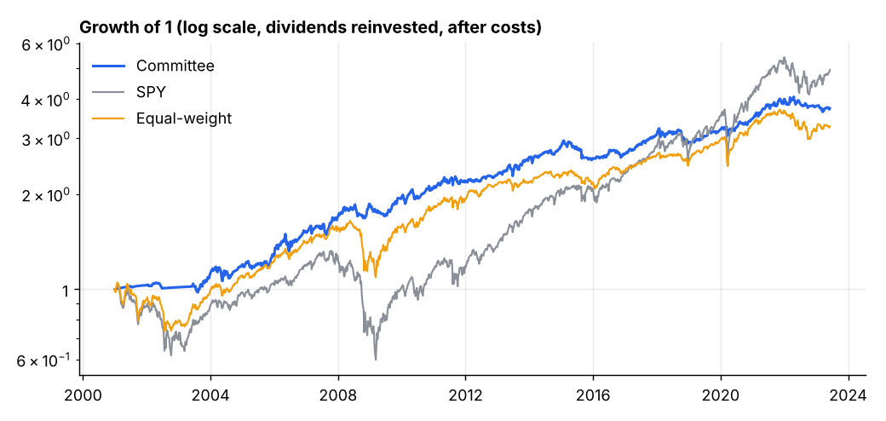
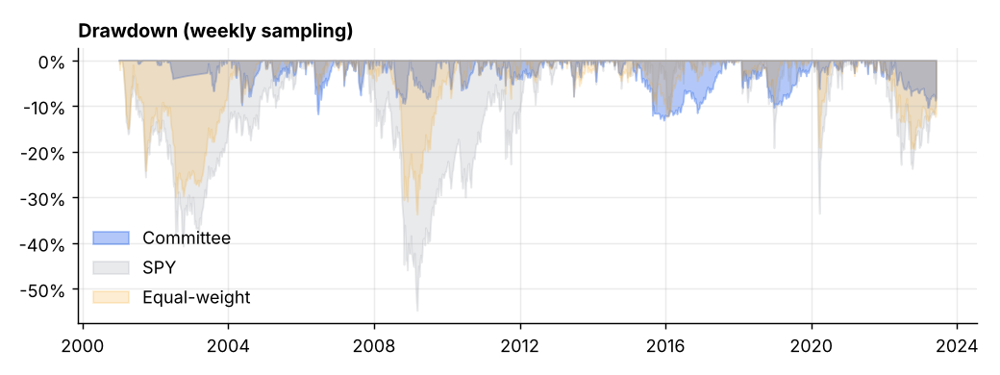
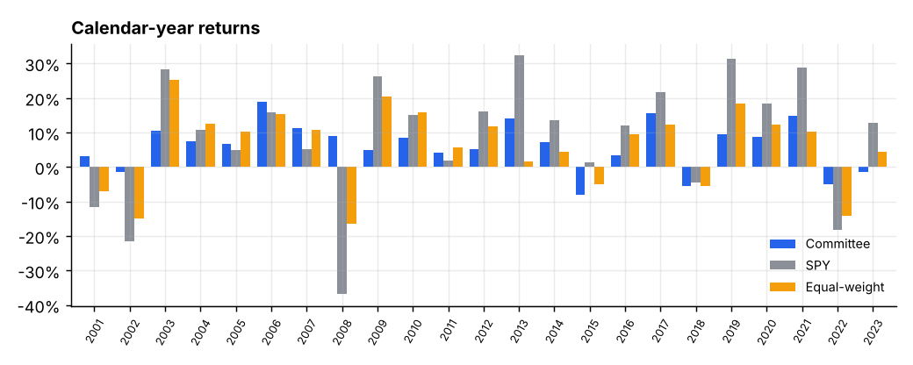
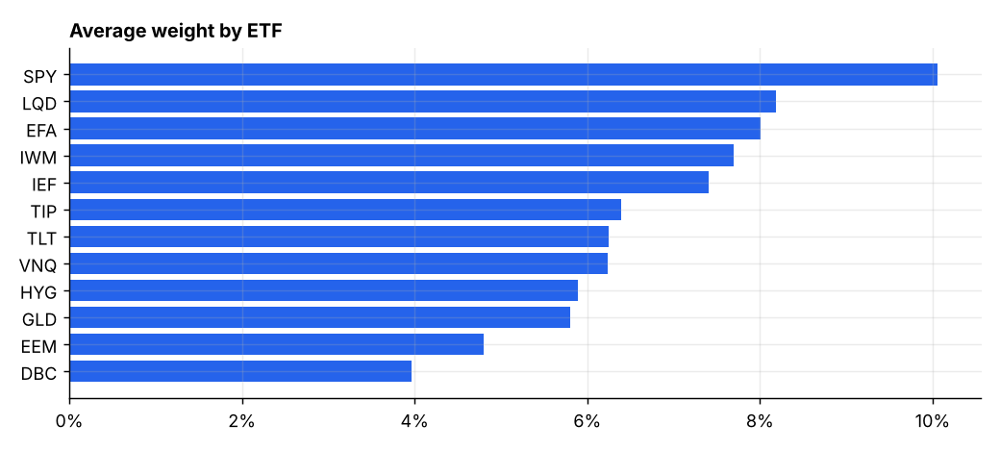

# Real-data study: ETF tactical allocation

_Data: rubetron/AssetAllocation R package data (Yahoo total returns, 2000-2023), daily dividend-adjusted prices, 12 assets, 2001-01-01 to 2023-06-09. Config `075f558b63db`._

> **Disclaimer.** Educational research. Not investment advice. A backtest is not a forecast: past performance does not predict future results.

## Headline
Over 2001-01-01 to 2023-06-09 the committee returned +6.1% a year (Sharpe 0.55, max drawdown -13.9%), against +7.4% (Sharpe 0.38, max drawdown -55.2%) for SPY and +5.5% (Sharpe 0.38, max drawdown -34.0%) for the equal-weight basket. Annualised excess return versus SPY: -2.0% (bootstrap 90% interval -7.1% to +2.9%): NOT statistically distinguishable from zero at the 90% level.

## Protocol (fixed before looking at results)
- Universe: SPY, IWM, EFA, EEM, TLT, IEF, LQD, TIP, GLD, VNQ, DBC, HYG (as supplied; membership must be fixed in advance and free of survivorship for the result to mean anything).
- Agents: momentum (12-1 month) and trend (price vs 200-day average). Value, quality and growth abstain because no point-in-time fundamentals exist for ETFs here.
- Default mandate, **nothing tuned on this sample**: min score 0.10, 25% position cap, -30% drawdown veto, monthly rebalance, 10 bps one-way cost, 1-day execution lag, cash earns the supplied short-term risk-free rate, Sharpe uses excess returns.
- Benchmarks: SPY buy-and-hold and the equal-weight basket (monthly rebalanced, no cost).

## Performance
|  | CAGR | Vol | Sharpe | Sortino | Max DD | Calmar |
|---|---|---|---|---|---|---|
| Committee | +6.1% | 8.3% | 0.55 | 0.70 | -13.9% | 0.44 |
| SPY | +7.4% | 19.2% | 0.38 | 0.48 | -55.2% | 0.13 |
| Equal-weight | +5.5% | 11.6% | 0.38 | 0.48 | -34.0% | 0.16 |

Sharpe and Sortino are computed on returns in excess of the 13-week T-bill rate.

## Relative to benchmarks
|  | Beta | Alpha (ann.) | Tracking error | Info ratio | Monthly hit rate |
|---|---|---|---|---|---|
| vs SPY | 0.15 | +4.7% | 18.0% | -0.15 | 43% |
| vs Equal-weight | 0.34 | +4.0% | 10.6% | 0.02 | 50% |

| Excess return vs | Months | Mean (ann.) | 90% interval | P(excess > 0) |
|---|---|---|---|---|
| SPY | 269 | -2.0% | -7.1% to +2.9% | 22% |
| Equal-weight | 269 | +0.4% | -3.0% to +3.4% | 51% |

Interval from a moving-block bootstrap (6-month blocks, 4000 resamples) of monthly active returns.

## Out-of-sample parameter selection (walk-forward)
Each year the best of 12 parameter sets (entry threshold x position cap) over the previous 4 years is applied to the next 12 months, so no parameter is ever chosen with knowledge of the period it trades. Span 2005-01-03 to 2023-06-09, 19 folds, 6 parameter switches (one full turnover of cost charged per switch).

|  | CAGR | Vol | Sharpe | Max DD |
|---|---|---|---|---|
| Walk-forward (parameters re-chosen yearly) | +6.8% | 7.9% | 0.68 | -12.8% |
| Fixed default mandate | +6.4% | 8.6% | 0.58 | -13.9% |
| SPY | +9.2% | 19.2% | 0.47 | -55.2% |

Re-choosing parameters on the past improved the Sharpe ratio versus the fixed default.

| Fold start | min_score | max_position | Train Sharpe | OOS return |
|---|---|---|---|---|
| 2005-01-03 | 0.10 | 15% | 0.83 | +6.0% |
| 2006-01-02 | 0.10 | 15% | 0.77 | +17.2% |
| 2007-01-01 | 0.00 | 15% | 1.11 | +12.3% |
| 2008-01-01 | 0.00 | 15% | 1.13 | +5.4% |
| 2009-01-01 | 0.10 | 15% | 1.13 | +6.0% |
| 2010-01-01 | 0.10 | 15% | 1.15 | +7.8% |
| 2011-01-03 | 0.10 | 15% | 0.96 | +4.0% |
| 2012-01-02 | 0.10 | 15% | 0.76 | +4.8% |
| 2013-01-01 | 0.00 | 15% | 0.76 | +9.4% |
| 2014-01-01 | 0.20 | 35% | 0.98 | +7.2% |
| 2015-01-01 | 0.20 | 35% | 1.01 | -7.0% |
| 2016-01-01 | 0.30 | 35% | 0.93 | +5.4% |
| 2017-01-02 | 0.30 | 35% | 0.98 | +18.6% |
| 2018-01-01 | 0.30 | 35% | 1.04 | -1.2% |
| 2019-01-01 | 0.30 | 15% | 0.67 | +7.8% |
| 2020-01-01 | 0.30 | 15% | 1.04 | +10.4% |
| 2021-01-01 | 0.30 | 15% | 1.18 | +14.4% |
| 2022-01-03 | 0.30 | 15% | 1.06 | -0.7% |
| 2023-01-02 | 0.30 | 15% | 1.09 | +1.2% |

## Sub-periods
| Period | Range |  | CAGR | Sharpe | Max DD |
|---|---|---|---|---|---|
| Full sample | 2001-01-01 to 2023-06-09 | Committee | +6.1% | 0.55 | -13.9% |
|  |  | SPY | +7.4% | 0.38 | -55.2% |
|  |  | Equal-weight | +5.5% | 0.38 | -34.0% |
| First half | 2001-01-01 to 2012-03-21 | Committee | +7.2% | 0.59 | -13.9% |
|  |  | SPY | +2.5% | 0.13 | -55.2% |
|  |  | Equal-weight | +6.5% | 0.37 | -34.0% |
| Second half | 2012-03-21 to 2023-06-09 | Committee | +4.9% | 0.52 | -13.4% |
|  |  | SPY | +12.6% | 0.71 | -33.7% |
|  |  | Equal-weight | +4.4% | 0.42 | -20.7% |

## Stress windows (fixed in advance)
| Window | Committee | SPY | Equal-weight |
|---|---|---|---|
| Global financial crisis (31 Oct 2007 - 9 Mar 2009) | +4.5% (DD -9.6%) | -54.7% (DD -54.7%) | -31.5% (DD -34.0%) |
| COVID crash (19 Feb - 23 Mar 2020) | -6.1% (DD -12.6%) | -33.7% (DD -33.7%) | -19.3% (DD -20.7%) |
| 2022 inflation / rate shock (calendar year) | -4.9% (DD -8.3%) | -18.2% (DD -24.5%) | -14.2% (DD -19.4%) |

## Calendar years

## Robustness
**Transaction costs** (committee only):
| Cost (bps one-way) | CAGR | Sharpe | Max DD |
|---|---|---|---|
| 0 | +6.4% | 0.59 | -13.8% |
| 10 | +6.1% | 0.55 | -13.9% |
| 25 | +5.6% | 0.50 | -14.0% |
| 50 | +4.8% | 0.41 | -15.0% |

**Parameter grid** (entry threshold x position cap). A result that only holds in one cell would be overfitted:
| min_score | max_position | CAGR | Sharpe | Max DD |
|---|---|---|---|---|
| 0.00 | 15% | +5.4% | 0.57 | -11.7% |
| 0.00 | 25% | +5.6% | 0.51 | -15.3% |
| 0.00 | 35% | +5.5% | 0.47 | -18.6% |
| 0.10 | 15% | +5.7% | 0.60 | -11.7% |
| 0.10 | 25% | +6.1% | 0.55 | -13.9% |
| 0.10 | 35% | +6.0% | 0.52 | -15.9% |
| 0.20 | 15% | +5.9% | 0.63 | -11.7% |
| 0.20 | 25% | +6.5% | 0.59 | -13.9% |
| 0.20 | 35% | +6.5% | 0.55 | -14.2% |
| 0.30 | 15% | +5.9% | 0.63 | -11.4% |
| 0.30 | 25% | +7.2% | 0.63 | -17.4% |
| 0.30 | 35% | +7.5% | 0.62 | -21.8% |

## Positioning
Average invested fraction 81%; months fully in cash 10%; average monthly turnover 26%.

Latest committee view (decision at the last close of the data, 2023-06-09; **not a recommendation**):
| ETF | Score | Target weight | Veto |
|---|---|---|---|
| EFA | +0.73 | 25.0% |  |
| SPY | +0.64 | 22.6% |  |
| GLD | +0.46 | 14.5% |  |
| IWM | +0.27 | 6.0% |  |
| EEM | +0.25 | 8.1% |  |
| HYG | +0.24 | 15.6% |  |
| LQD | +0.12 | 6.7% |  |
| IEF | +0.05 | 0.0% |  |
| TIP | +0.01 | 0.0% |  |
| TLT | -0.09 | 0.0% |  |
| VNQ | -0.11 | 0.0% |  |
| DBC | -0.61 | 0.0% |  |

## Limits
- Cash earns the supplied risk-free series while the benchmarks are always fully invested.
- Walk-forward treats each parameter set as an independent run and charges one full turnover per switch: an approximation, not an exact replay.
- The ETF list was chosen by the author knowing these funds still exist; mild selection effect remains.
- Costs are a flat one-way rate on turnover (no spreads, taxes or market impact).
- One path of history: statistical uncertainty is large (see the bootstrap interval).
- Momentum and trend effects are documented in published research but may weaken once widely known.

## References
- Faber, M. (2007). A Quantitative Approach to Tactical Asset Allocation. Journal of Wealth Management.
- Jegadeesh, N. and Titman, S. (1993). Returns to Buying Winners and Selling Losers: Implications for Stock Market Efficiency. Journal of Finance, 48(1), 65-91.
