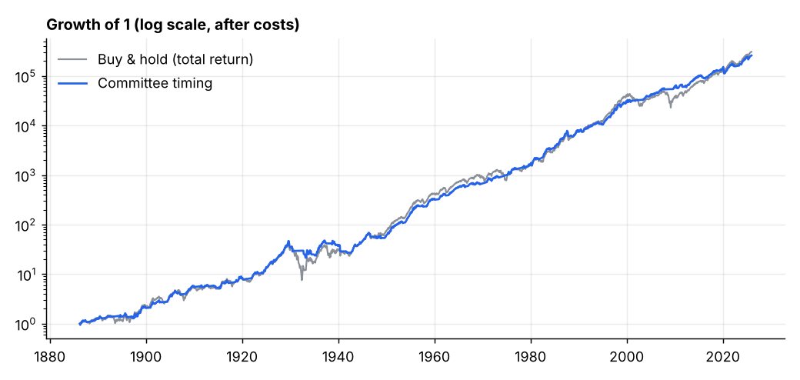
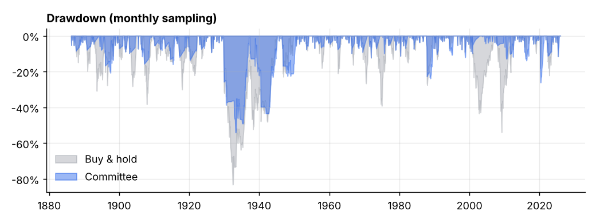
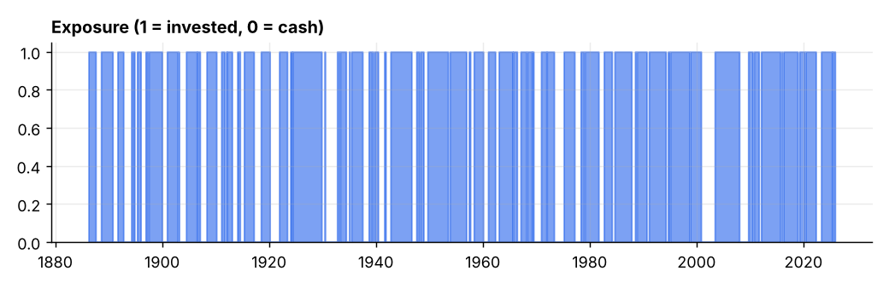

# Real-data study: committee timing on 140 years of US equities

_Data: SteelCerberus/us-market-data (MIT), daily total-return index and risk-free series, 1885-03-20 to 2025-12-19. Config `31870f26bd76`._

> **Disclaimer.** Educational research, not investment advice; a backtest is not a forecast. The data source itself states it is only suited to crude buy-and-hold backtests: results are indicative, not precise.

## Headline
Primary era 1962-06-18 to 2025-12-19: committee +10.8% a year (Sharpe 0.53, max drawdown -33.7%) versus buy-and-hold +10.9% (Sharpe 0.44, max drawdown -55.2%). Excess return -0.6% a year, 90% bootstrap interval -2.6% to +1.7%: NOT statistically distinguishable from zero. The timing overlay reduced the worst drawdown.

## Protocol (fixed before looking at results)
- Asset: US equity total-return index (Dow composite 1885-1927, S&P 500 from 1928; dividends added, 0.09% annual expense drag in the source). Cash earns the source's risk-free series.
- Committee: momentum (12-1 month) and trend (price vs 200-day average) agents with the default entry score 0.10, -30% drawdown veto, 10 bps one-way cost, decision at month-end close, execution one trading day later. Single asset, so the position cap is 100%: the committee is either fully invested or in cash.
- Primary era (highest data quality): 1962-2025 (S&P 500, Yahoo prices); other eras shown for context. Nothing tuned on the sample.

## Performance by era
| Era |  | CAGR | Vol | Sharpe | Max DD | Calmar |
|---|---|---|---|---|---|---|
| 1886-2025 (Dow composite before 1928) | Committee | +9.3% | 12.5% | 0.53 | -57.1% | 0.16 |
|  | Buy & hold | +9.5% | 17.5% | 0.43 | -83.6% | 0.11 |
|  | Cash | +3.1% | 0.2% | -0.00 | -0.0% | n/a |
| 1928-2025 (S&P 500 index) | Committee | +9.9% | 13.1% | 0.54 | -57.1% | 0.17 |
|  | Buy & hold | +10.1% | 18.7% | 0.44 | -83.6% | 0.12 |
|  | Cash | +3.3% | 0.2% | -0.00 | -0.0% | n/a |
| 1962-2025 (S&P 500, Yahoo prices) PRIMARY | Committee | +10.8% | 12.5% | 0.53 | -33.7% | 0.32 |
|  | Buy & hold | +10.9% | 16.5% | 0.44 | -55.2% | 0.20 |
|  | Cash | +4.5% | 0.2% | -0.00 | -0.0% | n/a |

Sharpe and Sortino are on returns in excess of the risk-free series.

## Statistical significance (moving-block bootstrap of monthly excess returns)
| Sample | Months | Excess (ann.) | 90% interval | P(excess > 0) |
|---|---|---|---|---|
| Full sample | 1671 | -0.9% | -2.7% to +0.9% | 20% |
| Primary era | 762 | -0.6% | -2.6% to +1.7% | 35% |

Excess return here is the annualised arithmetic mean of monthly differences, so it can differ from the gap between the two compound growth rates (lower volatility lowers the arithmetic mean less than the geometric one is lifted).

## Stress windows (fixed in advance)
| Window | Committee | Buy & hold |
|---|---|---|
| 1929 crash (3 Sep 1929 - 1 Jun 1932) | -37.7% (DD -41.6%) | -83.6% (DD -83.6%) |
| 1973-74 bear market (1 Jan 1973 - 1 Oct 1974) | +1.4% (DD -10.2%) | -43.3% (DD -43.9%) |
| Dot-com bust (1 Sep 2000 - 1 Oct 2002) | -1.1% (DD -12.5%) | -42.1% (DD -46.3%) |
| Global financial crisis (31 Oct 2007 - 9 Mar 2009) | -4.6% (DD -8.9%) | -54.7% (DD -54.7%) |
| COVID crash (19 Feb - 23 Mar 2020) | -33.7% (DD -33.7%) | -33.7% (DD -33.7%) |

## By decade
| Decade | CAGR committee | CAGR buy & hold | Max DD committee | Max DD buy & hold | Time invested |
|---|---|---|---|---|---|
| 1890s | +4.8% | +5.3% | -22.8% | -38.6% | 57% |
| 1900s | +10.9% | +9.2% | -16.0% | -38.7% | 63% |
| 1910s | +3.8% | +4.4% | -19.9% | -32.4% | 56% |
| 1920s | +15.2% | +14.1% | -35.5% | -44.1% | 73% |
| 1930s | +1.0% | +0.0% | -41.4% | -80.4% | 46% |
| 1940s | +4.6% | +9.0% | -31.6% | -31.0% | 60% |
| 1950s | +18.9% | +19.3% | -13.4% | -19.8% | 85% |
| 1960s | +7.2% | +7.7% | -12.3% | -26.7% | 68% |
| 1970s | +9.4% | +5.7% | -13.5% | -44.9% | 59% |
| 1980s | +17.3% | +17.7% | -32.9% | -32.9% | 77% |
| 1990s | +14.6% | +17.8% | -19.0% | -19.2% | 88% |
| 2000s | +6.8% | -0.9% | -12.9% | -55.2% | 57% |
| 2010s | +9.0% | +13.3% | -17.3% | -19.3% | 85% |
| 2020s | +9.9% | +14.9% | -33.7% | -33.7% | 79% |

## What drives the result (primary era)
| Variant | CAGR | Sharpe | Max DD |
|---|---|---|---|
| Committee (momentum + trend) | +10.8% | 0.53 | -33.7% |
| Momentum only | +9.8% | 0.45 | -33.7% |
| Trend only | +10.9% | 0.56 | -32.9% |

**Costs** (one-way, per switch):
| bps | CAGR | Sharpe | Max DD |
|---|---|---|---|
| 0 | +10.9% | 0.54 | -33.7% |
| 10 | +10.8% | 0.53 | -33.7% |
| 25 | +10.6% | 0.52 | -33.7% |
| 50 | +10.4% | 0.50 | -33.7% |
| 100 | +9.9% | 0.47 | -33.7% |

**Entry threshold** (min score). Caution: the default (0.10) was set in advance, but it happens to be the best cell of this table; its neighbours are weaker, so read the headline Sharpe as an optimistic estimate and prefer the walk-forward figures below:
| min_score | CAGR | Sharpe | Max DD |
|---|---|---|---|
| 0.00 | +10.1% | 0.47 | -33.7% |
| 0.10 | +10.8% | 0.53 | -33.7% |
| 0.20 | +9.8% | 0.47 | -33.7% |
| 0.30 | +9.4% | 0.47 | -32.9% |
| 0.40 | +8.2% | 0.38 | -32.9% |
| 0.50 | +7.3% | 0.32 | -32.9% |

## Walk-forward (out-of-sample parameter choice)
Each year the entry threshold with the best Sharpe over the previous 10 years is applied to the next year. Span 1896-04-01 to 2025-12-19, 130 folds, 31 switches.

|  | CAGR | Vol | Sharpe | Max DD |
|---|---|---|---|---|
| Walk-forward | +8.7% | 11.8% | 0.50 | -56.4% |
| Fixed default | +9.8% | 12.7% | 0.56 | -57.1% |
| Buy & hold | +10.0% | 17.7% | 0.45 | -83.6% |

Re-choosing the threshold each year on the past did **not** beat the fixed default out-of-sample: adaptive tuning added noise, not value.

## Limits
- Data quality: daily series with interpolated values, a Dow composite before 1928, and approximated risk-free rates before 1926; early costs and liquidity were very different from 10 bps.
- A total-return index is not directly investable; no taxes, no spreads or market impact.
- One history: the bootstrap interval measures sampling noise, not regime change.
- Data ends at the source snapshot date shown above, not today.

## References
- Faber, M. (2007). A Quantitative Approach to Tactical Asset Allocation. Journal of Wealth Management.
- Jegadeesh, N. and Titman, S. (1993). Returns to Buying Winners and Selling Losers. Journal of Finance, 48(1).
